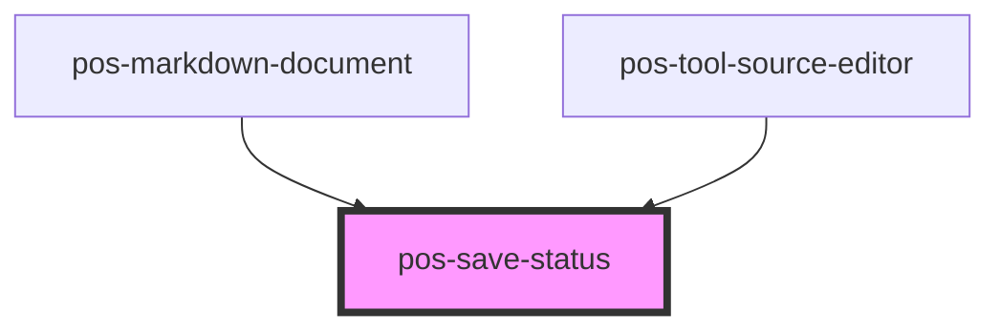

# pos-save-status

<!-- Auto Generated Below -->

## Properties

| Property                  | Attribute     | Description | Type                                          | Default     |
| ------------------------- | ------------- | ----------- | --------------------------------------------- | ----------- |
| `saveStatus` _(required)_ | `save-status` |             | `"failed" \| "idle" \| "pending" \| "saving"` | `undefined` |

## Dependencies

### Used by

 - [pos-markdown-document](../pos-markdown-document)
 - [pos-tool-source-editor](../../tools/pos-tool-source-editor)

### Graph

----------------------------------------------

*Built with [StencilJS](https://stenciljs.com/)*
