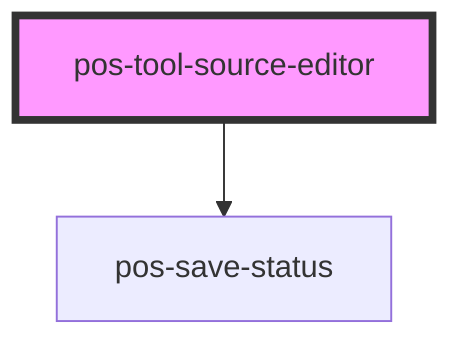

# pos-tool-source-editor

<!-- Auto Generated Below -->

## Overview

A tool to edit the source code of a document

## Events

| Event          | Description | Type               |
| -------------- | ----------- | ------------------ |
| `pod-os:error` |             | `CustomEvent<any>` |

## Dependencies

### Depends on

- [pos-save-status](../../components/pos-save-status)

### Graph

----------------------------------------------

*Built with [StencilJS](https://stenciljs.com/)*
