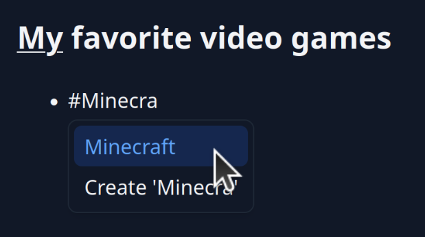
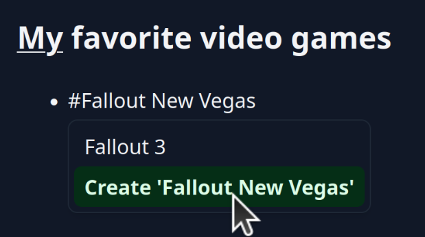
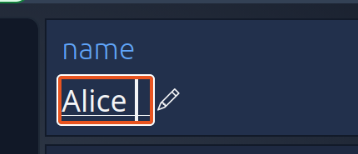

---
date:
  created: 2026-11-04
---

# PodOS 2026.11: Create on the fly, mention things and edit literals

Our November release introduces the long-awaited editing of literal values and an exciting new feature that links your Markdown documents to anything on your Pod. You can even create new stuff as you type!

## Mention anything from your Markdown notes

{ align=right width="300" }

Capturing your thought in a quick Markdown note is a good way to begin something new. What starts as a word can evolve into a real thing on your Pod. Perhaps you are already planning for Christmas and want to mention `#Grandma's cookies` recipe which you created with Umai? With the new `#`-mention you can link anything. All the things that you can find through the navigation bar are mentionable. Use the "Make findable" feature to add something to the items you want to access quickly.

## Create new things as you type

{ align=left width="300" }

The mention feature is not limited to existing content. You can also create a new thing from the words you type instantly. Continue writing your document or follow the link to add structured data about the mentioned item, or use the "Open with" feature to switch to a more suitable app. Starting from Markdown, you can evolve your thoughts to real data assets that can be used within the Solid app ecosystem.

## Edit literal values

{ align=right width="300" }

Adding literal values to an item was already possible through the "Data" tool in PodOS Browser. Now you can also edit those values directly, to rename something or fix a typo. It's certainly not the most impressive feature, but an important foundation for actually being in charge of your own data without needing a specific app.

## Full changelogs

PodOS 2026.11 includes the following components:

- @pod-os/elements 0.45.1
- @pod-os/core 0.34.0

For those of you interested in the full list of changes, here are the release
notes:

- [@pod-os/elements](https://github.com/pod-os/PodOS/blob/2026.11/elements/CHANGELOG.md#changelog)
- [@pod-os/core](https://github.com/pod-os/PodOS/blob/2026.11/core/CHANGELOG.md#changelog)
